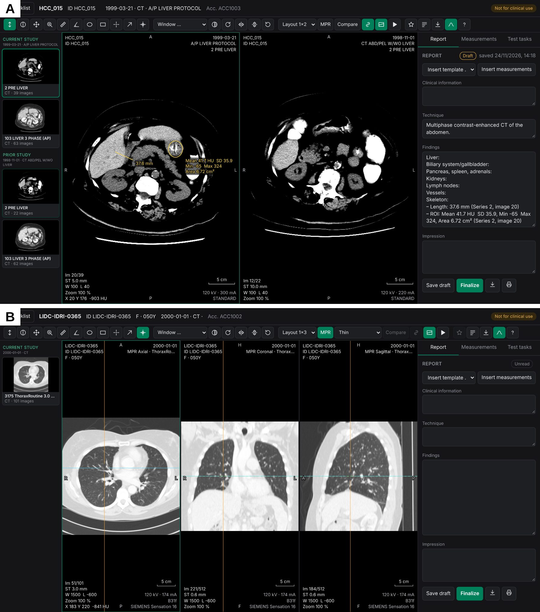
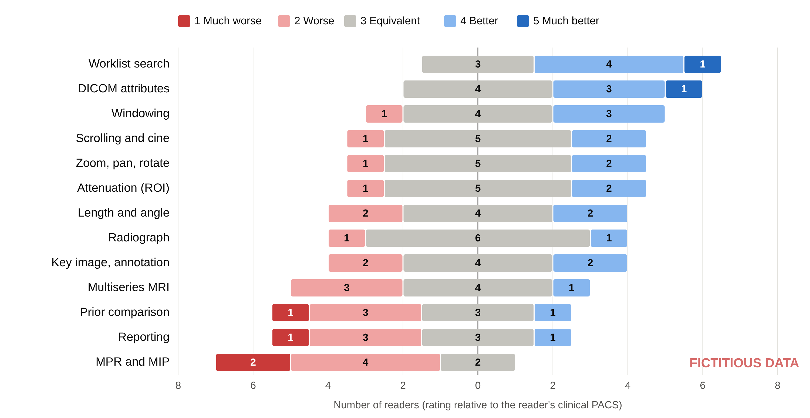

**Article type:** Research Letter (*Radiology*)

**Authors:** Jonathan Kottlors, MD [confirm degree]; Nedim Beste, [degree]; David Maintz, MD;
Andra-Iza Iuga, MD [confirm degree]

**Affiliation (all authors):** Institute for Diagnostic and Interventional Radiology, Faculty of
Medicine and University Hospital Cologne, University of Cologne, Kerpener Str 62, 50937 Cologne,
Germany

**Corresponding author:** Jonathan Kottlors ([e-mail]). **ORCID:** A.-I.I. 0000-0002-3694-0235;
others [to be added].

**Summary statement:** An AI coding agent built a working web-based PACS in about 1 hour for
$21; radiologists rated it [close to their clinical PACS for basic tasks].

> **FICTITIOUS RATINGS.** All reader results in this draft (values in [square brackets] in the
> Results, and Figure 2) are invented to show the layout. They are not data and must be replaced
> with the export from the study before anyone outside the author group sees this text.

## Introduction

A picture archiving and communication system (PACS) is the most expensive software a radiology
department buys and the one it can least change. Large language model (LLM) coding agents now
write software from plain-language instructions ("vibe coding"), and radiologists have started to
build small tools this way (1). We asked a blunter question: can a radiologist, without writing
a line of code, have an agent build the whole PACS — and would colleagues want to read on it?

## Materials and Methods

This prospective feasibility study used only public, de-identified images; [institutional review
board statement]. Readers provided [informed consent].

**System generation.** In November 2026, one radiologist instructed an LLM coding agent
([agent, model, version, and manufacturer: see submission copy]) to build a complete PACS. The first request was one paragraph plus
three multiple-choice answers; a second paragraph requested adaptation to a department (name,
color scheme, window presets) and central storage of ratings. No code was written or edited by
humans, and existing viewer frameworks (2) were not used. Effort and cost were taken from the
session log. The serverless application (3600 lines of JavaScript, no third-party
dependencies) comprises a DICOM parser and decoders, archive index, worklist, multi-viewport
viewer (windowing, measurements, multiplanar reformation, prior comparison), structured
reporting, and encrypted accounts (Figure 1), hosted on free services. Six studies (631 DICOM
objects; CT, MRI, radiography) from the Imaging Data Commons (3) served as test data. Decoded
pixels were compared with an independent toolkit.

**Reader evaluation.** [Eight] radiologists ([three] residents, [five] board certified; median
experience, [6] years) performed 13 tasks. For each task, completion
and a five-point comparison with the reader's clinical PACS (1 = much worse, 3 = equivalent,
5 = much better) were recorded in the application. Readers completed the System Usability
Scale (SUS; range, 0–100) (4,5) and six five-point agreement items. Data are reported
descriptively.

## Results

The first tested version existed 35 minutes after the initial request; departmental adaptation
and central rating storage took 14 more minutes. Human input totaled two free-text messages and
three multiple-choice answers; usage cost for the session, including manuscript drafting, was
about $21. Decoded pixels were bit-identical to the reference toolkit in 58 of 61 test objects
(95%).

All [eight] readers completed the evaluation. Of [104] task attempts, [87] ([84]%) succeeded
without problems, [14] ([13]%) with difficulty, and [three] ([3]%) failed. The median rating
relative to the clinical PACS was [3] (IQR, [2–3]); basic viewing matched the clinical system,
whereas multiplanar reformation, prior comparison, and reporting fell short (Figure 2). The mean
SUS score was [74] ± [11]. [Seven] of [eight] readers considered image quality adequate for
diagnostic viewing, and [five] could imagine clinical use given regulatory clearance. Readers
most often missed [hanging protocols, volume rendering, and speech recognition].

## Discussion

One hour and the price of a lunch bought a PACS that radiologists [rated as equivalent to their
clinical system for everyday viewing]. Commercial PACS cost orders of magnitude more in licenses
and maintenance [source to be verified], and every change is a vendor request; here, a
department rebranded and reconfigured the system with one paragraph of text. The comparison is
unfair in an instructive way: commercial prices pay for integration, validated storage, service,
cybersecurity, and regulatory compliance — exactly what our system lacks. Diagnostic viewing
software is a regulated medical device, and AI-generated code may carry vulnerabilities its
users cannot see (6). Limitations include a small curated data set, no DICOM networking or
information-system integration, no diagnostic accuracy assessment, and unblinded readers. Writing
imaging software is no longer the hard part. Proving that it is safe is, and that is where
radiology's attention should now go.

## References

1. Bera K, Kayat Bittencourt L, Ramaiya N, Tirumani SH. Vibe coding in radiology: Claude Code and
   ChatGPT Codex leading to the rise of the radiologist-developer. J Am Coll Radiol
   2026;23(7):1283–1288. doi:10.1016/j.jacr.2026.04.008 [verify]
2. Ziegler E, Urban T, Brown D, et al. Open Health Imaging Foundation Viewer: an extensible
   open-source framework for building web-based imaging applications to support cancer research.
   JCO Clin Cancer Inform 2020;4:336–345. doi:10.1200/CCI.19.00131 [verify]
3. Fedorov A, Longabaugh WJR, Pot D, et al. National Cancer Institute Imaging Data Commons: toward
   transparency, reproducibility, and scalability in imaging artificial intelligence.
   RadioGraphics 2023;43(12):e230180. doi:10.1148/rg.230180 [verify]
4. Brooke J. SUS: a "quick and dirty" usability scale. In: Jordan PW, Thomas B, Weerdmeester BA,
   McClelland AL, eds. Usability Evaluation in Industry. London, England: Taylor & Francis,
   1996; 189–194.
5. Bangor A, Kortum PT, Miller JT. An empirical evaluation of the System Usability Scale. Int J
   Hum Comput Interact 2008;24(6):574–594. doi:10.1080/10447310802205776 [verify]
6. Perry N, Srivastava M, Kumar D, Boneh D. Do users write more insecure code with AI assistants?
   In: Proceedings of the 2023 ACM SIGSAC Conference on Computer and Communications Security.
   2023; 2785–2799. doi:10.1145/3576915.3623157 [verify]

## Figures

**Figure 1:** Screenshots of the AI-generated PACS. **(A)** Liver CT side by side with the prior
examination; length and region-of-interest measurements are transferred to the structured
report. **(B)** Multiplanar reformation of a chest CT with linked crosshair. Images: HCC-TACE-Seg
and LIDC-IDRI collections, Imaging Data Commons.

**Figure 2:** Reader ratings of 13 standard PACS tasks relative to each reader's clinical PACS
(diverging stacked bars centered on "equivalent"; numbers are readers). **Fictitious data for
layout only.**
